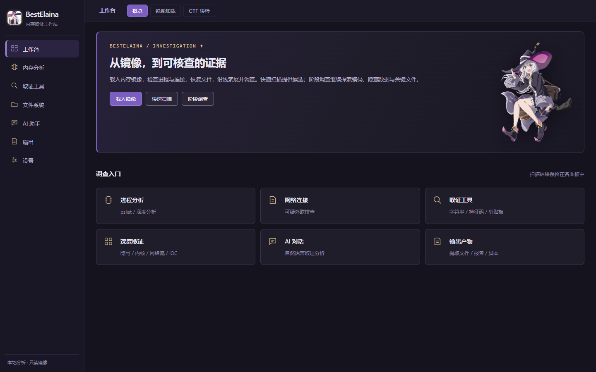

# BestElaina — AI 内存取证工作站（Windows 便携版）

喜欢这个工具的话，欢迎点一个 **Star** ⭐。

BestElaina 是一款面向 Windows 的**内存取证工作站**，将镜像分析、进程与网络调查、缓存文件恢复、证据预览和 AI 助手放进同一个桌面界面。银紫暗色主题，适合学习内存取证、调查练习和 CTF 证据分析。

- **免安装**：下载 ZIP，解压即可使用，自带 Volatility 3 独立引擎、符号库与随包工具（7-Zip / steghide / Volatility 2）。
- **普通分析不依赖 AI**：全部本地取证功能开箱即用；需要助手时，在设置里接入你自己的模型 API（Key 只存在你本机）。
- **只读分析**：程序不会修改被分析的镜像文件。

## 下载

前往 **[Releases](../../releases)** 页面下载最新的 `BestElaina_Workstation_*_Hardened_Windows_x64.zip`（附 `.sha256` 校验文件）。

> 注意：GitHub 自动生成的 "Source code" 压缩包不是软件本体，请下载 Assets 中的便携版 ZIP。

## 安装与首次使用

1. 完整解压 ZIP 到**可写文件夹**（保留主程序、`_internal`、`vol3` 目录结构，不要只复制一个 EXE）。
2. 运行 `BestElaina_Workstation.exe`。若系统缺少 WebView2，按提示安装微软运行时即可。
3. 首次启动会自动运行自检（也可手动运行 `BestElaina_Workstation.exe --self-test`，结果写入同目录 `self-test.json`）。
4. 在「工作台 → 镜像加载」选择 `.raw` / `.vmem` / `.mem` / `.dmp` 等内存镜像开始分析。

## 功能概览

| 模块 | 能力 |
| --- | --- |
| 工作台 | 镜像加载（含哈希校验）、原始字节查看、本机进程内存采集生成练习镜像 |
| CTF 快检 | 一键 CTF 分析、自动解题、解题规划器、格式诊断与自动转换链（gzip/base64/hex/XOR/ROT 等）、文件雕刻（PNG/JPEG/PDF/ZIP/RAR/7z/SQLite…）、痕迹扫描（flag/Base64/URL/IP/SSH 私钥…）、YARA、HTML 报告与复现脚本 |
| 内存分析 | 进程列表/进程分析/网络连接/文件扫描（Volatility 3 引擎，MiniDump 内建支持） |
| 文件系统 | 内存缓存文件虚拟浏览与导出（NTFS VFS） |
| 取证工具 | 高频取证、深度取证、扩展工具（注册表 hive、浏览器痕迹、剪贴板、加密容器、隐写检测等） |
| AI 助手 | 接入你自己的模型 API；助手可调用取证工具、串起证据链并输出题解草稿 |
| 输出 | Markdown 题解、自包含 HTML 报告、时间线、复现脚本 |

## 能力边界（诚实声明）

- 内存镜像不是完整磁盘：文件浏览展示的是**内存缓存与驻留记录中仍存在**的内容，可能缺页、截断。
- Volatility 分析依赖镜像结构适配；不保证所有 Windows/Linux/损坏镜像都支持。
- AI 结果受模型能力、网络许可与额度影响；**它不会代替镜像里缺失的字节，也不保证每道题都能自动解开**。
- 恶意程序只做静态分析；本工具不要求关闭杀毒软件。

## 许可与使用限制

本软件采用 **[BestElaina 非商业使用许可](LICENSE-BestElaina.txt)**：

- ✅ 免费下载、个人学习 / 课堂教学 / CTF 训练 / 安全研究使用；
- ✅ 原样完整转发分享（不收费、不拆包）；
- ❌ 禁止倒卖、付费分发、捆绑收费；
- ❌ 禁止逆向、拆包提取源代码；
- ❌ 禁止分发修改版或移除版权与构建标识；
- 💼 商业用途需联系作者取得书面授权。

每份发行包带有唯一构建水印用于溯源，倒卖与抄袭行为将依法追责。

## 反馈

使用问题请提交 [Issues](../../issues)。
