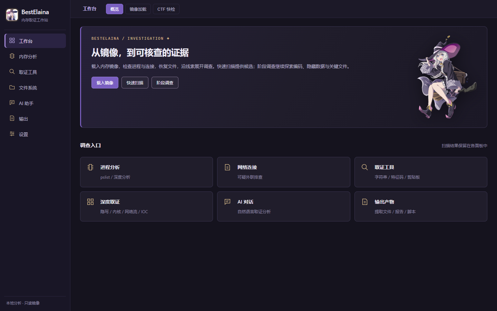

# BestElaina

如果喜欢该项目的话，请点一个**star**吧~

BestElaina 官方公开发布页（非商业许可）。

BestElaina 是一款面向 Windows 的内存取证工作站，将镜像分析、进程与网络调查、缓存文件恢复、证据预览和 AI 助手放在同一个桌面界面里。采用银紫暗色与伊蕾娜主题，适合学习内存取证、调查练习和 CTF 证据分析。

普通分析不需要 AI。需要助手时，接入自己的模型 API；助手可以调用取证工具，并把结论连接到实际证据。它不会代替镜像里缺失的字节，也不保证每道题都能自动完成。

**当前版本：3.3.0-rc1，Windows 便携版。** [下载便携版与校验文件](https://github.com/KivenMit/BestElaina-Release/releases/tag/v3.3.0-rc1)。包内带独立引擎、符号和随包工具；启动自检通过不等于全部实验自动解题通过。

## 导航

- [验证与能力边界](#验证与能力边界)
- [下载、安装与首次使用](#下载安装与首次使用)
- [功能概览](#功能概览)
- 详细功能手册（随包 `docs/FEATURES.md`）
- 安装与配置指南（随包 `docs/INSTALL.md`）
- 常见问题（随包 `docs/TROUBLESHOOTING.md`）
- 发行后模型复测（随包 `docs/POST_RELEASE_VALIDATION.md`）
- 验收记录（随包 `docs/VALIDATION.md`）
- 源码恢复与重新构建（随包 `docs/SOURCE_RESTORE.md`）
- [使用与发布许可](#使用与发布许可)

## 验证与能力边界

BestElaina 可以用于定位进程、连接、命令历史、注册表和浏览器痕迹，恢复内存缓存或驻留记录中仍存在的文件内容，并进一步分析图片、文本、压缩包、密码库和静态程序线索。恢复结果保留来源和哈希；不完整内容、歧义字符和待验证候选会分开显示。

验证分为两类：**模块与诊断复现**检查特定证据链是否可用；**模型冷启动验收**只给普通模型原始镜像和官方题面，让它自行调用工具。两者不能互相代替。

截至 2026-10-10，已在 MemLabs 六个镜像及 OtterCTF 镜像上开展开发诊断，覆盖控制台、图像与隐写、密码库、删除文件驻留记录、静态程序字符串、公开网络线索和托管加密恢复。**这不表示七个实验已经自动解出。**

| 实验例子 | 题面标注难度／方向 | 当前验证范围 |
| --- | --- | --- |
| MemLabs Lab1 — Beginner's Luck | Easy；命令历史、画布与文件恢复 | 模块诊断和普通模型尝试；可自动解出 |
| MemLabs Lab2 — A New World | Easy；环境变量、密码库与浏览器线索 | 链路模块诊断；2026-10-10 冷启动有阶段证据，可自动解出 |
| MemLabs Lab3 — The Evil's Den | Easy–Medium；编码、加密与隐写 | 最终源码 GLM Flash 冷启动23轮、25次工具调用无异常；可ai解出 |
| MemLabs Lab4 — Obsession | Medium；重要删除文件 | 2026-10-10 GLM Flash 冷启动 4 轮、4 次工具调用完成本地证据闭合； |
| MemLabs Lab5 — Black Tuesday | Medium–Hard；多阶段文件与程序线索 | 压缩包、图像和静态 PE 链路诊断；最终源码冷启动57次工具调用无异常，一个阶段本地闭合；三阶段未全通过 |
| MemLabs Lab6 — The Reckoning | Hard；浏览器与公开分享链 | 已有证据上的下载与 MAC 验证复现； |
| OtterCTF — Recovery / Closure 等 | 用户信息、感染来源及托管加密恢复 | 最终源码冷启动59次工具调用无异常； |

题面难度来自实验作者，**不代表工具已达到同等难度的通用自动解题能力**。不会用格式校验通过、找到一个像答案的字符串或任务运行结束代替验收。

需要了解的限制：

- 内存镜像不是完整磁盘。文件浏览器展示可恢复的内存缓存与记录，可能缺页、截断、存在多个缓存版本。
- Volatility 分析依赖适配的操作系统、符号和镜像结构；不能保证所有 Windows、Linux 或损坏镜像都支持。
- OCR 和模型视觉可能混淆 `O/0`、`I/1`；解密得到可读文本也不一定具有完整性认证。
- AI 结果受模型能力、工具支持、网络许可和服务额度影响。仅 GLM Flash 已开展实际验收，不能据此声称其他模型全部兼容或通过。
- 恶意程序只做静态分析；本工具不要求关闭杀毒软件。隔离可能影响某些恢复产物，需要结合原始证据继续分析。

## 下载、安装与首次使用

1. 在本仓库 **Releases** 下载 Windows 便携版 ZIP。GitHub 的“Source code”自动压缩包不是桌面安装包。
2. 完整解压到可写文件夹，保留主程序、`_internal`、`vol3` 及其符号和随包工具；不要只复制一个 EXE。
3. 打开 `BestElaina_Workstation.exe`。如果系统缺少 WebView2，按安装指南（随包 `docs/INSTALL.md`）安装。
4. 在工作台加载本地镜像，确认引擎状态，先进行进程、网络或文件分析。
5. 按需进入设置配置自己的 API 地址、模型和密钥，再使用 AI 助手。网络线索访问和图像能力按需要启用；模型费用由你的 API 服务商收取。

普通使用者无需安装 Python 或 Node。是否需要额外符号或某项可选工具，以发行包说明和功能状态为准。

详细步骤：安装与配置 · 问题排查（两篇随包 `docs/INSTALL.md` / `docs/TROUBLESHOOTING.md`）

## 功能概览

| 工作区域 | 可以做什么 |
| --- | --- |
| 工作台与镜像加载 | 加载本地镜像、查看基础状态、进入常用调查任务 |
| 进程与网络 | 进程树、命令行、模块、句柄、连接与可疑行为线索 |
| 文件调查与浏览器 | 筛选内存文件记录，预览、选择和提取恢复内容，区分缓存变体与不完整文件 |
| 自动分析 | 组合扫描、雕刻、痕迹和恢复能力，输出待核查候选与证据 |
| AI 助手 | 自主工具调用、实际进度、停止任务、上下文证据和结果说明；支持 OpenAI 兼容及原生 Anthropic 协议 |
| 深度证据分析 | 注册表、浏览器、时间线、剪贴板、字符串、IOC、规则和 YARA 等线索 |
| 文件内容分析 | 编码和 XOR、压缩包、KeePass、OCR、隐写、静态 PE 与 .NET、加密参数证据 |
| 公开网络线索 | 在明确允许联网后跟进受约束的公开链接及分享链，记录下载和验证结果 |
| 输出与报告 | 管理结果、记录来源与哈希，导出便于复核的分析报告 |

完整说明和操作入口见详细功能手册（随包 `docs/FEATURES.md`）。部分深度恢复能力由自动分析或助手调用，不能把它们理解为每个页面都有独立“一键完成”按钮。

## 使用与发布许可

本软件按 [LICENSE-BestElaina.txt](LICENSE-BestElaina.txt)（非商业使用许可）发布：允许免费下载、个人学习/教学/CTF/安全研究使用与原样完整分享；禁止倒卖、拆包提取源码、分发修改版；商业使用需作者书面授权。本仓库不授予其他人额外的再分发权。

## 反馈问题

请说明版本、镜像类型、操作步骤、错误提示及能否复现；如涉及 API，仅说明服务商、模型和错误码。**不要在 Issue 中上传密钥、真实内存镜像、个人密码或未经许可的样本。**

调查结论应回查来源，不把 AI 输出直接视为事实。
